<!--
  Generated by Readme Studio (https://readme.niessen.dev/).
  Edit readme.config.json instead of this file: the Readme Studio workflow rebuilds it.
  Open the design in the visual editor: https://readme.niessen.dev/#/studio?repo=DavidNiessen/readme-studio
  Agent guide: https://readme.niessen.dev/llms.txt
-->

<p align="center">
<a href="https://readme.niessen.dev"><picture><source media="(prefers-color-scheme: dark)" srcset="https://raw.githubusercontent.com/DavidNiessen/readme-studio/readme-studio/hero-dark.svg"><source media="(prefers-color-scheme: light)" srcset="https://raw.githubusercontent.com/DavidNiessen/readme-studio/readme-studio/hero-light.svg"></picture></a>
</p>

<p align="center">
<a href="https://github.com/DavidNiessen/readme-studio/actions/runs/46028465996"><picture><source media="(prefers-color-scheme: dark)" srcset="https://raw.githubusercontent.com/DavidNiessen/readme-studio/readme-studio/shields-ci-dark.svg"><source media="(prefers-color-scheme: light)" srcset="https://raw.githubusercontent.com/DavidNiessen/readme-studio/readme-studio/shields-ci-light.svg"></picture></a>
<a href="https://github.com/DavidNiessen/readme-studio/releases/tag/v1.2.0"><picture><source media="(prefers-color-scheme: dark)" srcset="https://raw.githubusercontent.com/DavidNiessen/readme-studio/readme-studio/shields-version-dark.svg"><source media="(prefers-color-scheme: light)" srcset="https://raw.githubusercontent.com/DavidNiessen/readme-studio/readme-studio/shields-version-light.svg"></picture></a>
<a href="https://github.com/DavidNiessen/readme-studio/issues"><picture><source media="(prefers-color-scheme: dark)" srcset="https://raw.githubusercontent.com/DavidNiessen/readme-studio/readme-studio/shields-issues-dark.svg"><source media="(prefers-color-scheme: light)" srcset="https://raw.githubusercontent.com/DavidNiessen/readme-studio/readme-studio/shields-issues-light.svg"></picture></a>
<a href="https://github.com/DavidNiessen/readme-studio/pulls"><picture><source media="(prefers-color-scheme: dark)" srcset="https://raw.githubusercontent.com/DavidNiessen/readme-studio/readme-studio/shields-prs-dark.svg"><source media="(prefers-color-scheme: light)" srcset="https://raw.githubusercontent.com/DavidNiessen/readme-studio/readme-studio/shields-prs-light.svg"></picture></a>
</p>

<p align="center">
<a href="https://github.com/DavidNiessen/readme-studio/graphs/contributors"><picture><source media="(prefers-color-scheme: dark)" srcset="https://raw.githubusercontent.com/DavidNiessen/readme-studio/readme-studio/contributors-dark.svg"><source media="(prefers-color-scheme: light)" srcset="https://raw.githubusercontent.com/DavidNiessen/readme-studio/readme-studio/contributors-light.svg"></picture></a>
</p>

<p align="center">
<a href="https://github.com/DavidNiessen/readme-studio/releases"><picture><source media="(prefers-color-scheme: dark)" srcset="https://raw.githubusercontent.com/DavidNiessen/readme-studio/readme-studio/changelog-dark.svg"><source media="(prefers-color-scheme: light)" srcset="https://raw.githubusercontent.com/DavidNiessen/readme-studio/readme-studio/changelog-light.svg"></picture></a>
</p>

## What it is

Readme Studio has four parts:

| Part | Where | What it does |
|---|---|---|
| **Studio** | [`apps/web`](apps/web) | A web designer (hosted on GitHub Pages). Design a **profile** README or a **project** README: pick one of 18 presets or start blank, arrange 54 widgets, tune 17 palettes, 12 typefaces, radius, texture and motion, and preview in GitHub's dark and light themes at desktop or phone width. Exports a ready-to-commit project. |
| **Action** | [`action.yml`](action.yml), [`packages/engine`](packages/engine) | Runs in your profile or project repository on a cron. Fetches your GitHub data (account or repository), renders every widget as an animated SVG (or GIF), force-pushes the images to an asset branch and updates `README.md` when the layout changed. |
| **Browser extension** | [`apps/extension`](apps/extension) | [Chrome Web Store](https://chromewebstore.google.com/detail/readme-studio/khjacbeebimgffcjldkojaflahigfhko); Firefox is in review. On GitHub, **Edit README** opens the same studio as an overlay on the repository page with its committed design, keeps a draft per repository, and **Save to GitHub** writes it back: as a commit, a pull request, or through GitHub's own editor. |
| **Core** | [`packages/core`](packages/core) | The isomorphic renderer shared by both: themes, fonts with real text metrics, widgets, the config schema and the README composer. The studio preview and the action produce byte-identical SVGs. |

Everything is static: no server, no database, no third-party image host. Your design lives in your browser and in your repository.

## Quick start

1. Open the [studio](https://readme.niessen.dev/#/studio) and design your README (or pick a preset).
2. Click **Save to GitHub**. With a personal access token it commits the design and the workflow (or opens a pull request); without one, GitHub's own editor opens and you commit there. Skip to step 4.

   Or choose **Export manually** in that dialog (or press Ctrl/⌘ E) and download the project. It contains:
   ```
   readme.config.json              your design
   .github/workflows/readme-studio.yml    the scheduled workflow
   README.md                       the generated layout
   SETUP.md                        these steps in detail
   ```
3. Push the files to the repository named after your username (`<you>/<you>`), or to the project's repository.
4. In **Settings → Actions → General**, set **Workflow permissions** to **Read and write**, then run the `readme` workflow once from the **Actions** tab.

From then on the README rebuilds itself on the schedule you picked.

## Using it with AI agents

Agents can design, check and hand over a README without the web UI:

- **[`llms.txt`](https://readme.niessen.dev/llms.txt)** and **[`llms-full.txt`](https://readme.niessen.dev/llms-full.txt)** describe the workflow, the config and every widget option; **[`widgets.json`](https://readme.niessen.dev/widgets.json)**, **[`presets.json`](https://readme.niessen.dev/presets.json)** and **[`schema.json`](https://readme.niessen.dev/schema.json)** are the same as data.
- The bundled CLI runs without installing anything: `node packages/engine/dist/cli.mjs init|validate|build|link|widgets|presets|themes|schema` (`--json` for machine-readable output).
- `link` prints a studio URL that opens the agent's design in the visual editor; `#/studio?repo=owner/name` opens a committed config.
- The [`readme-studio` skill](https://github.com/DavidNiessen/skills) teaches agents the whole workflow: `npx skills add DavidNiessen/skills --skill readme-studio`.

## The action

```yaml
name: Readme Studio
on:
  schedule:
    - cron: "17 2 * * *"
  workflow_dispatch:
  push:
    paths: [readme.config.json, .github/workflows/readme-studio.yml]

permissions:
  contents: write

jobs:
  render:
    runs-on: ubuntu-latest
    steps:
      - uses: actions/checkout@v4
      - uses: DavidNiessen/readme-studio@v1
        with:
          config: readme.config.json
          # profile-token: ${{ secrets.PROFILE_TOKEN }}
```

| Input | Default | Description |
|---|---|---|
| `config` | `readme.config.json` | Path to the config exported from the studio. |
| `token` | `${{ github.token }}` | Pushes the assets and README (needs `contents: write`). |
| `profile-token` | | Optional fine-grained PAT for private contribution counts and exact totals. |
| `asset-branch` | `output.branch` | Branch the rendered images are force-pushed to. |
| `commit-readme` | `true` | Commit `README.md` when the generated layout changed. |
| `readme-path` | `README.md` | Where to write the README. |
| `output-dir` | temp dir | Keep the rendered files here. |
| `mock` | `false` | Deterministic sample data instead of the API (testing). |
| `dry-run` | `false` | Render only. Pull requests and branches other than the default branch always run dry. |

Outputs: `assets-dir`, `readme-changed`, `data-source`.

**Data sources.** With a token the action uses GitHub GraphQL (calendar, totals, pinned repos, languages, releases). Without one it falls back to the REST API plus the public contributions calendar. Weather comes from Open-Meteo, blog posts from any RSS/Atom feed. Only public repositories are ever named.

## Browser extension

The extension puts the studio inside GitHub. Every repository gets a button in the corner: **Edit README** when it has a `readme.config.json`, **Design README** when it has none (the options page can limit that to your profile repository). It opens the studio as an overlay on the page, with the committed design loaded; click outside it or press Esc to close. The toolbar button does the same. It is the same studio as the website, not a copy: [`apps/extension`](apps/extension) mounts `apps/web`'s studio and adds the GitHub side.

Each repository keeps its own draft: close the overlay, open another repository, come back, and your unsaved changes are still there. The top bar says when the design differs from the repository's, with **Reset** to go back to the committed one, and reopening a repository with unsaved changes says so too (and whether the repository's design has changed since). A private repository asks you to sign in; one that GitHub does not show at all says 404.

**Save to GitHub** writes `readme.config.json` (and the workflow, if the repository has none), and the readme workflow renders the rest:

- **Commit** straight to the branch, or **Pull request** from a new branch. Both need a GitHub account: **Sign in with GitHub** (OAuth device flow; the build or the options page supplies an OAuth App client ID with *Enable Device Flow* ticked) or a personal access token (fine-grained: Contents and Workflows read & write; classic: `public_repo`, or `repo` for private repositories, and `workflow`). The website's studio has the same **Save to GitHub** with a token, since GitHub's device flow does not answer web pages.
- **GitHub editor** needs no sign-in: GitHub's editor opens with the new file filled in, and you review the diff and commit there.

Install it from the [Chrome Web Store](https://chromewebstore.google.com/detail/readme-studio/khjacbeebimgffcjldkojaflahigfhko). The Firefox version is in review at Firefox Add-ons; until it is listed, open `readme-studio-firefox-*.zip` from the latest [release](https://github.com/DavidNiessen/readme-studio/releases/latest) in `about:debugging`. Every release also carries `readme-studio-chrome-*.zip`, to load unpacked (`chrome://extensions`, Developer mode).

## Project READMEs

Switch a design to **Project**, enter `owner/name` and, if you publish one, the npm, PyPI or crates.io package. Project widgets then read that repository: a project hero, live shields (one clickable image per badge), an install terminal, a code snippet, a features grid, repository stats, star history, a contributor wall with embedded avatars, weekly commit activity, repository vitals with CI status, package downloads, a changelog from your releases, a roadmap from your milestones, a sponsor card and a table of contents. Prose stays real Markdown, so docs remain searchable. The action runs in the project repository and publishes the images to an orphan branch there.

## Widgets

<details>
<summary><b>54 widgets in 7 categories</b></summary>

| Category | Widgets |
|---|---|
| Header | Hero banner, statement banner, project hero |
| Identity | Social pills, terminal, tech-stack orbit, about card, quick facts, badges, skills, timeline, contact card, local clock, shields, contributor wall, support card |
| Stats | Stats board, languages, trophies, streak card, language donut, year in review, follower milestone, repository stats, repository vitals, downloads |
| Activity | Contribution graph, heartbeat, 3D skyline (GIF), coding rhythm, journey, departure board, trend chart, weekday rhythm, harvester, star history, commit activity |
| Projects | Now building, project card, top repositories, releases, latest posts, changelog, roadmap |
| Content | Today (date, moon, weather, quote), quote, markdown text, install command, code snippet, features grid, table of contents |
| Decoration | Divider, footer, section heading |

</details>

Every widget is hand-drawn SVG with CSS/SMIL animation (no JavaScript, so it survives GitHub's sanitiser). Every one respects three motion levels and `prefers-reduced-motion`, renders twice (dark and light) and is served with `<picture>` so it matches the visitor's theme.

## Development

Requires Node 22.

```bash
npm ci
npm run dev          # studio at http://localhost:5173
npm test             # core + engine tests
npm run typecheck
npm run example      # render examples/ with sample data → examples/dist/preview.html
npm run bundle       # rebuild packages/engine/dist (commit the result)
npm run extension    # browser extension → apps/extension/dist/{chrome,firefox} and their zips
```

CLI:

```bash
npx tsx packages/engine/src/cli.ts build --config readme.config.json --out dist [--mock] [--only=hero,stats] [--now=2026-12-31T23:00:00Z]
npx tsx packages/engine/src/cli.ts validate --config readme.config.json
npx tsx packages/engine/src/cli.ts init --login you --preset minimal-paper   # or --preset oss-library
npx tsx packages/engine/src/cli.ts presets [--kind project] [--json]
npx tsx packages/engine/src/cli.ts widgets [--kind project] [--type shields] [--json]
npx tsx packages/engine/src/cli.ts link        # open the config in the studio
```

### Layout

```
apps/web            Vite + React studio, landing page, presets and docs (GitHub Pages)
apps/extension      Chrome + Firefox extension: mounts apps/web's studio over GitHub and saves back to the repository
packages/core       renderer: themes, fonts + metrics, widgets, config schema, README composer
packages/engine     Node runtime: live data, scraping fallback, resvg GIF raster, CLI, publisher, action entry
examples            the project the studio exports, rendered by CI
scripts             asset generation (fonts, icons), JSON schema, widget contact sheet
```

### Adding a widget

1. Create `packages/core/src/widgets/<name>.ts` with `defineWidget({...})`: `type`, `title`, `description`, `category`, `kind`, `width`, `defaults`, `fields` (they generate the inspector UI automatically) and `render(ctx, options)`.
2. Add it to one of the `set-*.ts` lists.
3. Run `npm test`. Every widget is rendered in several palettes, fonts, motion levels and with empty and hostile data, and the output is validated as XML.
4. `npx tsx scripts/preview-widgets.ts /tmp/sheet crimson dark` renders a contact sheet of all widgets.

### Releasing

- **Pre-releases are automatic.** Every push to `main` runs the checks and publishes a GitHub pre-release such as `v1.0.1-42` (next patch plus the run number). Pin one with `uses: DavidNiessen/readme-studio@v1.0.1-42` to try the newest work. Only the newest three are kept, and they never move the `v1` tag.
- **Full releases are manual.** Run **Actions → Release → Run workflow** on `main` and choose a `patch`/`minor`/`major` bump or type an exact version. The workflow runs the checks, commits the version onto a `vX.Y.Z` tag, publishes the release with generated notes, brings `main` up to the new version and moves the floating major tag (`v1`) that profile repositories use.

Pre-releases and releases carry the browser extension for Chrome and Firefox as zips. A full release also publishes it to the stores when their keys are set up: the secrets `CHROME_EXTENSION_ID`, `CHROME_CLIENT_ID`, `CHROME_CLIENT_SECRET` and `CHROME_REFRESH_TOKEN` for the Chrome Web Store, and `AMO_JWT_ISSUER` and `AMO_JWT_SECRET` for Firefox Add-ons (submit the first Firefox version by hand). Without them that step is skipped. The repository variable `OAUTH_CLIENT_ID` builds the OAuth App client ID for "Sign in with GitHub" into the extension.

Commit the action bundle (`npm run bundle`) before merging; CI fails when it is stale.

### GitHub Pages

The `pages` workflow builds `apps/web` on every push to `main`. Enable it once in **Settings → Pages → Source: GitHub Actions**.

## Contributing

Bug reports, widget ideas, presets and pull requests are welcome. [CONTRIBUTING.md](CONTRIBUTING.md) explains the setup, how the code fits together and how to add a widget. Please follow the [code of conduct](CODE_OF_CONDUCT.md); report security problems privately as described in [SECURITY.md](SECURITY.md); questions go to [SUPPORT.md](SUPPORT.md).

## License

MIT © David Nießen. Bundled fonts are licensed under the SIL Open Font License; brand icons come from Simple Icons (CC0) and Font Awesome Free (CC BY 4.0), and line icons from Lucide (ISC). See [`packages/core/assets/LICENSES.md`](packages/core/assets/LICENSES.md).

<p align="center">
<a href="https://readme.niessen.dev/"><picture><source media="(prefers-color-scheme: dark)" srcset="https://raw.githubusercontent.com/DavidNiessen/readme-studio/readme-studio/footer-dark.svg"><source media="(prefers-color-scheme: light)" srcset="https://raw.githubusercontent.com/DavidNiessen/readme-studio/readme-studio/footer-light.svg"></picture></a>
</p>
